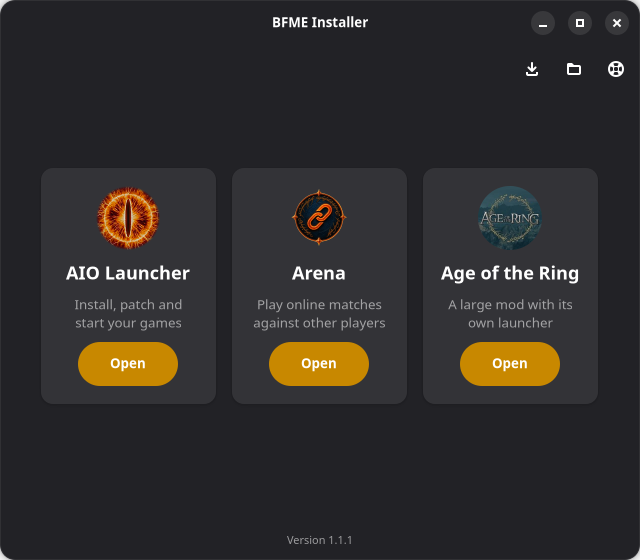
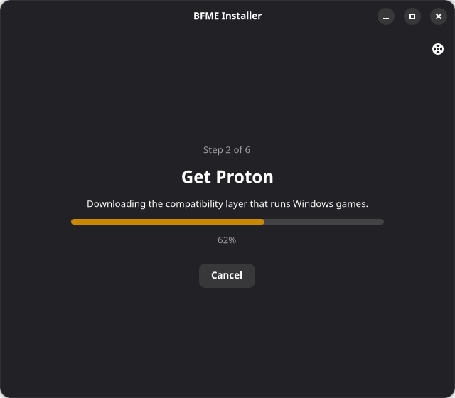
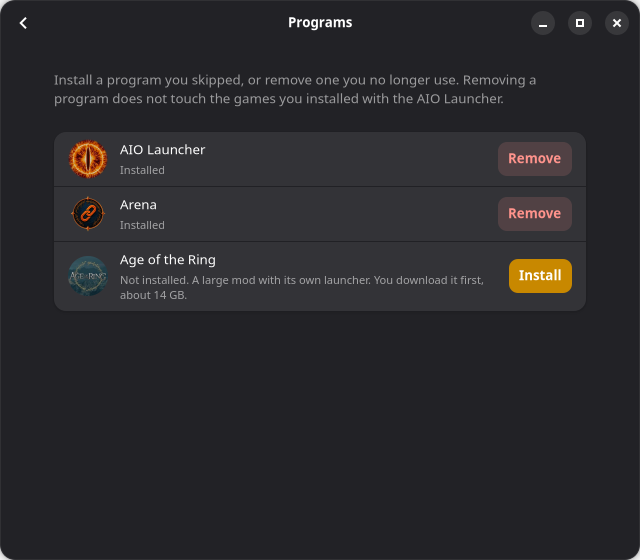
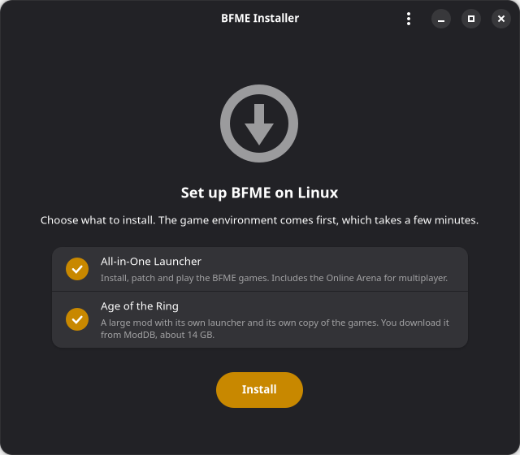
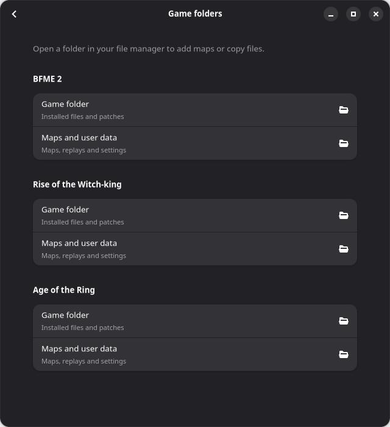
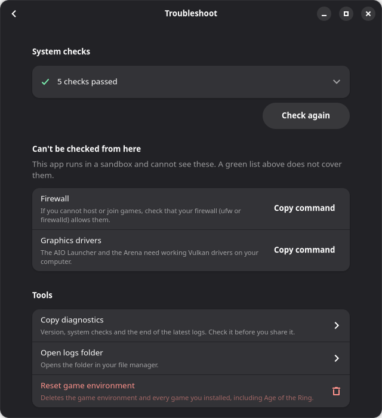

<div align="center">

# BFME Installer

**Play Battle for the Middle-earth on Linux, from one guided setup.**

Installs and runs the All-in-One Launcher, Online Arena, and Age of the Ring under Proton.

[](https://github.com/JGBMichalski/bfme-installer/releases/latest)
[](https://github.com/JGBMichalski/bfme-installer/actions/workflows/build-linux.yml)
[](LICENSE)



</div>

## Why

Running these games on Linux used to mean hand-building a Wine prefix, picking the right DLL overrides, and fixing the
multiplayer "Out of Sync" error by trial and error. BFME Installer does that once, the same way every time, and then
gets out of your way.

- **One command to install.** Paste one line into a terminal and the wizard opens on a page where you choose what to install.
- **Install only what you want.** Choose the All-in-One Launcher (the Arena comes with it), Age of the Ring, or both.
- **A guided window.** Checks your system, downloads Proton, builds the game environment and tells you in plain words
  when something needs your attention.
- **AIO Launcher and Arena side by side.** Both share one game environment, so maps and games installed in one are there
  in the other.
- **Age of the Ring.** You download the file from ModDB and the app does the rest.
- **Online play with Windows players.** The prefix settings that stop "Out of Sync" errors are applied for you.
- **Updates itself.** The app tells you when a new release exists and installs it through Flatpak.
- **Easy to fix.** A Troubleshoot page re-runs the system checks, copies a report for bug reports, opens the logs, and
  can reset the game environment.

## Screenshots

| Set up | Home | Programs |
| :---: | :---: | :---: |
|  |  |  |
| Step-by-step progress, with Cancel and Resume. | Open what you installed. The buttons at the top right lead to the other pages. | Install a program you skipped, or remove one. |

<details>
<summary>More screenshots</summary>

<br>

| Start | Game folders | Troubleshoot |
| :---: | :---: | :---: |
|  |  |  |

</details>

## Install

Copy this into a terminal:

```sh
curl -fsSL https://github.com/JGBMichalski/bfme-installer/releases/latest/download/install-flatpak.sh | bash
```

It installs the app as a Flatpak, adds the 32-bit parts Flatpak needs, and opens the setup wizard, which walks you through the rest.

The same commands are also available on the [install page](https://jgbmichalski.github.io/bfme-installer/).

To update, press **Update** in the app when it offers one, or run the same command again.

The app asks for one permission beyond its own data: access to `~/.local/share/applications`, your menu folder, which is how it adds and removes the shortcuts of the programs you install.

### Requirements

- A 64-bit (x86_64) Linux distribution with [Flatpak](https://flatpak.org/setup/). The installer prints the command for
  your distribution if Flatpak is missing.
- Working Vulkan drivers, 64-bit and 32-bit. The wizard checks this and shows the fix when something is missing.
- Enough free disk space for Proton and the games. The wizard checks this too.
- A copy of the games. The AIO Launcher installs and patches them.

## Using it

1. Open **BFME Installer** from your menu. Tick what you want, the **All-in-One Launcher**, **Age of the Ring**, or
   both, and press **Install**. Nothing is ticked at first. The first run downloads Proton, so it takes a few minutes.
   You can cancel and resume.
2. If you chose the AIO Launcher, open it from the home screen and install your games.

The home screen shows only what you installed. Three buttons in the top right corner lead to everything else:

| Button | Opens |
| :---: | --- |
| download arrow | **Programs**: install one you skipped, or remove one you no longer use. |
| folder | **Game folders**: your games' folders and maps. |
| lifebuoy | **Troubleshoot**: when something goes wrong. |

Skipped something? Press the download arrow and then **Install** next to it. Changed your mind? **Remove** takes one program out (its files and its shortcut) and keeps your games, your other programs and the settings Age of the Ring keeps in your own folder. You can install it again later.

Each program you install gets a shortcut in your application menu, and only while it is installed. **Reset** removes them all, and a program you delete yourself loses its shortcut the next time you open BFME Installer.

### Install Age of the Ring

[Age of the Ring](https://www.moddb.com/mods/the-horse-lords-a-total-modification-for-bfme) is not part of the AIO Launcher. It has its own launcher and its own copies of BFME 2 and the Rise of the Witch-king, so it does not touch the games you already have. It does not need the AIO Launcher or the Arena either.

1. Tick **Age of the Ring** on the first page, or press **Install** next to it on the Programs page later. The setup prepares the game environment first, then stops at the download step.
2. Press **Open ModDB**, click **Download Now**, and wait until your browser has finished the file (about 14 GB). ModDB only lets a web browser download it, so the app cannot do this step for you.
3. Back in the app, press **Choose file...** and pick the zip you downloaded. Do not unpack it. The app checks it, unpacks it, installs the mod and shows its progress. You need about 40 GB of free space, and the install can take an hour.
4. When it is done you can delete the zip. The card now says **Open**. The Age of the Ring Launcher updates the mod itself.

Not ready to download 14 GB? Press **Back to start** (or **Back to home**) on the download step. Whatever finished before it stays installed. If the file turns out to be unfinished or damaged, the app says so and offers **Choose another file**.

Resetting the game environment also deletes Age of the Ring. To take out only Age of the Ring, use **Remove** on the Programs page.

### Add maps and copy files

Press the folder button in the top right corner of the home screen. Each installed game, and Age of the Ring, has two buttons:

- **Game folder**: the installed files and patches.
- **Maps and user data**: where the game keeps its maps, replays and settings. The game creates this folder the first
  time it runs, so for a game you have not started yet the button opens the game folder instead.

The folders open in your file manager, so you can drop in maps or copy over existing files. A game that is not installed
is not listed.

### When something goes wrong

Open **Troubleshoot** with the lifebuoy button in the top right corner, which is there on every page. It can:

- re-run the system checks and show a fix command you can copy;
- copy a diagnostics report for a bug report (check it first, because it can contain your home folder name);
- open the logs folder;
- **reset** the game environment. This deletes the environment *and every installed game*, then starts the setup again.
  Downloads and Proton are kept.

## Without Flatpak

Run the setup script in a terminal. It does the same setup without the wizard.

```sh
./scripts/bfme-linux-setup.sh doctor     # check requirements
./scripts/bfme-linux-setup.sh install    # set up the runner, AIO Launcher, Arena and menu shortcuts
```

Then open **BFME All-in-One Launcher** from your menu and install the games. Start the Arena from its own
**BFME Online Arena** shortcut.

Only want Age of the Ring? Skip `install` and prepare the game environment on its own, then give it the file you downloaded from ModDB:

```sh
./scripts/bfme-linux-setup.sh prepare
./scripts/bfme-linux-setup.sh aotr-install ~/Downloads/AotR_Standalone_9.3.0_Installer.zip
```

Other commands: `launcher-install` (the AIO Launcher and the Arena, after `prepare`), `launcher`, `arena`, `aotr`,
`game bfme1|bfme2|rotwk`, `shortcuts`, `status`, `reset-prefix --yes`, `version`, `help`.
Configuration variables (such as `BFME_HOME` and `BFME_RUNNER=wine`) are in [How it works](docs/how-it-works.md).

## Planned

This is a direction, not a promise, and it has no dates.

- [ ] **Repair.** Fix a damaged setup without deleting the game environment, so [Reset](#when-something-goes-wrong) is not the only way out.
- [ ] **Error details.** An expandable log on the "Something went wrong" screen, so you can see what failed without opening the logs folder.

## Contributing

Bug reports and pull requests are welcome. See [CONTRIBUTING.md](CONTRIBUTING.md) for more information. When you report a problem, press **Copy diagnostics** on the Troubleshoot page and paste the report into the issue.

