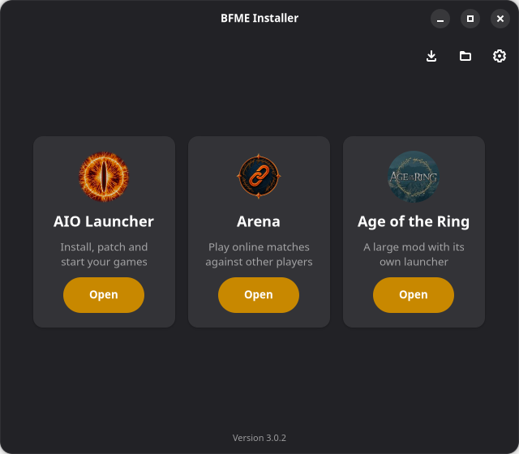
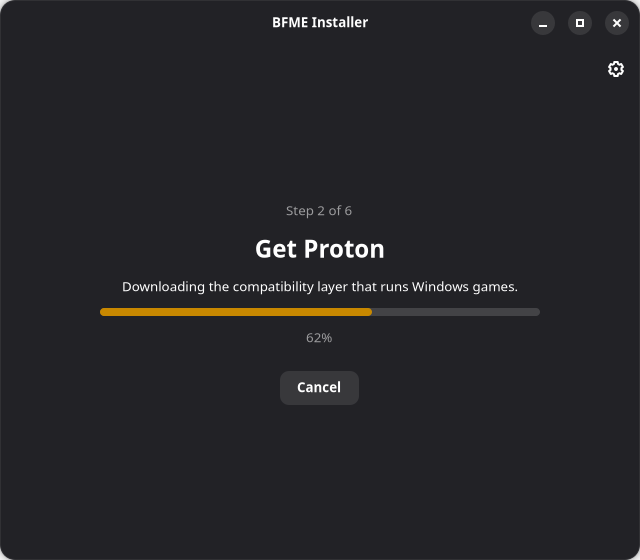
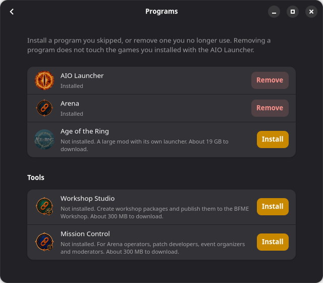
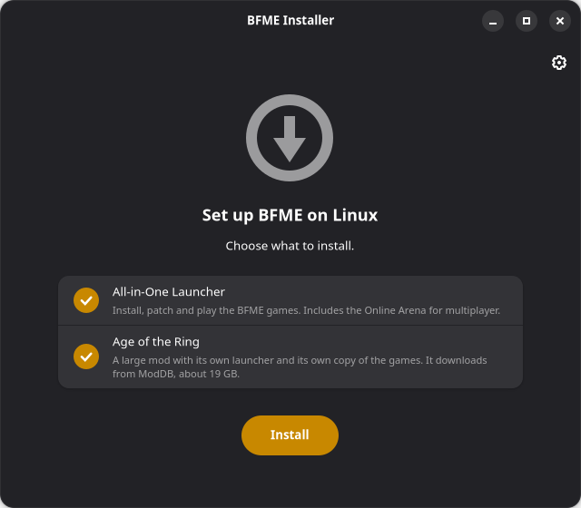
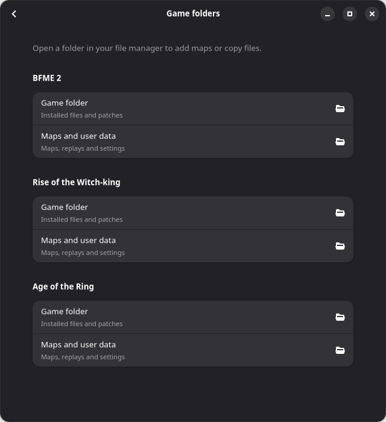
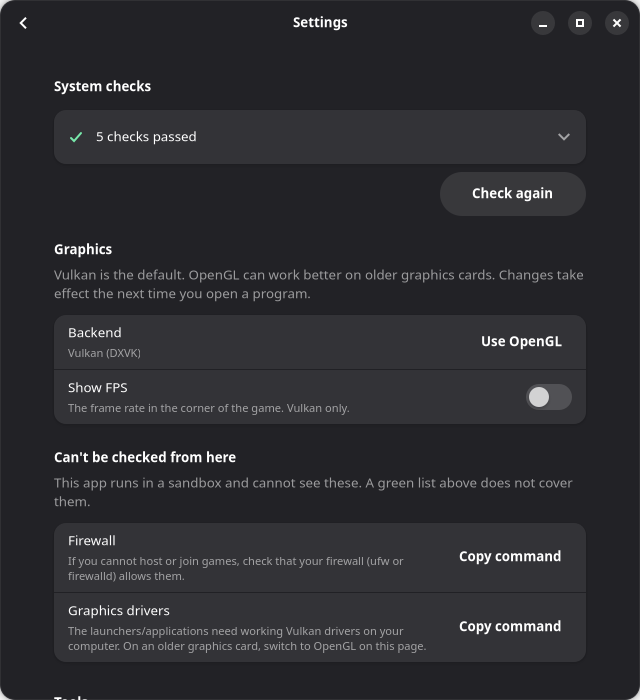

<div align="center">

# BFME Installer

**Play Battle for Middle-earth on Linux.**

Installs and runs the All-in-One Launcher, the Online Arena and Age of the Ring under Proton.

[](https://github.com/JGBMichalski/bfme-installer/releases/latest) [](https://github.com/JGBMichalski/bfme-installer/actions/workflows/build-linux.yml) [](LICENSE)



</div>

## Screenshots

| Set up | Home | Programs |
| :---: | :---: | :---: |
|  |  |  |

<details>
<summary>More screenshots</summary>

| Start | Game folders | Settings |
| :---: | :---: | :---: |
|  |  |  |

</details>

## Install

Run this in a terminal, and the setup walks you through the rest:

```sh
curl -fsSL https://github.com/JGBMichalski/bfme-installer/releases/latest/download/install-flatpak.sh | bash
```

You need:

- A 64-bit (x86_64) Linux distribution with [Flatpak](https://flatpak.org/setup/).
- Working 64-bit and 32-bit Vulkan drivers. Older graphics cards can use OpenGL instead (see [Settings](#settings)).
- About 30 GB of free disk space, and about 47 GB more for Age of the Ring.

To update, press **Update** in the app, or run the install command again. To uninstall, run it with `--uninstall`, which keeps your games, or `--purge`, which deletes them too:

```sh
curl -fsSL https://github.com/JGBMichalski/bfme-installer/releases/latest/download/install-flatpak.sh | bash -s -- --uninstall
```

## Using it

1. Open **BFME Installer** from your menu, tick what you want and press **Install**. The first run downloads Proton, which takes a few minutes.
2. Open the **AIO Launcher** and install your games.
3. To play online, open the **Arena** from the home screen or its menu shortcut, not from the AIO Launcher's Multiplayer tab.

Don't switch patches in the AIO Launcher once a game is installed. It has broken BFME 2 under Wine before.

The buttons in the top right corner of the home screen open:

| Button | Opens |
| :---: | --- |
| download arrow | **Programs**: install something you skipped, or remove a program. Your games stay. |
| folder | **Game folders**: each game's files, and its maps and settings. |
| gear | **Settings**: see [Settings](#settings). |

### Age of the Ring

[Age of the Ring](https://www.moddb.com/mods/the-horse-lords-a-total-modification-for-bfme) has its own launcher and its own copies of BFME 2 and Rise of the Witch-king, so it leaves your other games alone and doesn't need the AIO Launcher. Tick it on the first page, or press **Install** next to it on the Programs page. The app downloads it from ModDB (about 19 GB) and installs it, which can take an hour or more. If the download fails, press **Retry** later.

## Settings

**Settings** (the gear button, on every page) can:

- run the system checks again and give you the fix for anything that fails;
- switch the graphics between Vulkan (the default) and OpenGL, choose the graphics card on a computer with two, and show an FPS counter;
- copy a diagnostics report for a bug report (read it first, it can contain your home folder name);
- open the logs folder and the settings file;
- **reset** the game environment, which deletes *every installed game* and starts the setup again.

If the games are slow or won't start on an older graphics card, try OpenGL.

### Settings file

**Open settings file** opens `config.env` in the app's data folder, `~/.var/app/com.jgbmichalski.BfmeInstaller/data/bfme-installer`, which also holds the game environment and the logs.

| Setting | Purpose |
| --- | --- |
| `BFME_GRAPHICS` | `vulkan` or `opengl`. |
| `BFME_GPU` | `auto`, `dedicated` or `integrated`: which card runs the games on a computer with two. |
| `BFME_EXTRA_ENV` | Extra environment variables for the programs, such as `DXVK_HUD=fps`. |
| `BFME_PROTONPATH` | A Proton to use instead of the built-in one. |
| `BFME_KEEP_AOTR_DOWNLOAD` | `1` keeps the Age of the Ring download after installing it. |

## Contributing

Bug reports and pull requests are welcome; see [CONTRIBUTING.md](CONTRIBUTING.md). When you report a problem, include the report from **Copy diagnostics** in Settings.
